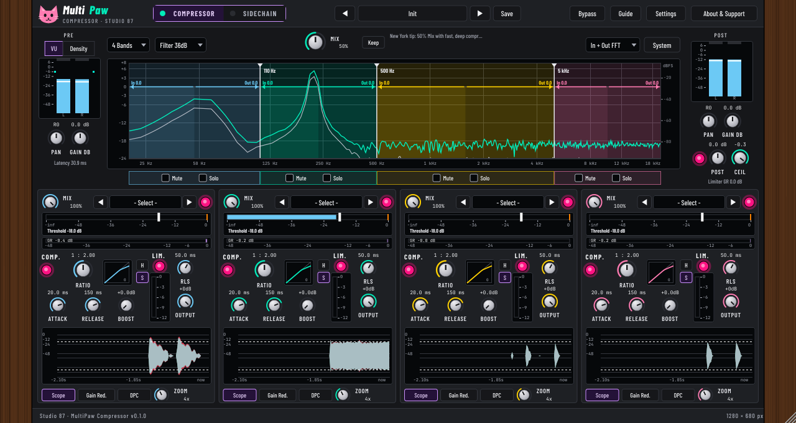
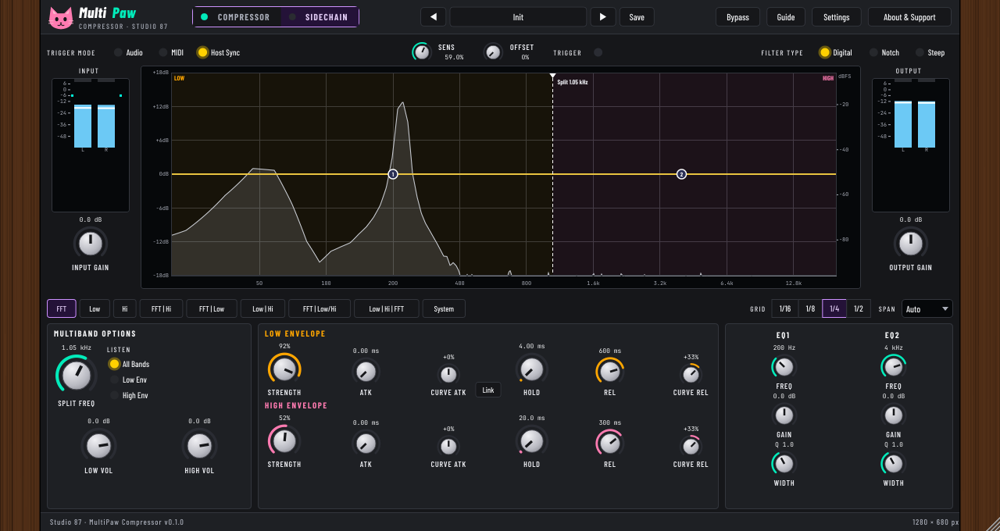

# MultiPaw Compressor

A free, open source, cat-themed multiband compressor and multiband sidechain in one plugin (VST3, Linux first). Two pages, one toggle: **Compressor** (up to 4 bands, per band compressor and limiter, DPC pattern compressor, master limiter) and **Sidechain** (low and high envelopes, audio, MIDI or host sync trigger, two EQs, editable envelope curves).

## Status
Test release v0.1.1 (pre-release). The plugin is built natively in JUCE from the approved mockup: both pages, linear-phase crossovers, per band compressor and limiter, DPC patterns, sidechain page, presets and a manual. Not tuned by ear in a DAW yet, so expect rough edges.

## Download
- [MultiPawCompressor-0.1.1.zip](https://github.com/SpeakingColors/multipawcompressor/releases/download/v0.1.1/MultiPawCompressor-0.1.1.zip): installers, manual and instructions in one zip
- [Release page](https://github.com/SpeakingColors/multipawcompressor/releases/tag/v0.1.1)
- [Manual](docs/manual.html)

## Try the mockup
Open `docs/mockup/MultiPaw.html` in a browser.

## Support

  

Free and open source, made by one person. If it helps your music, a coffee on [Ko-fi](https://ko-fi.com/studio87) keeps it coming.

## License
AGPL-3.0-or-later, see [LICENSE](LICENSE).
